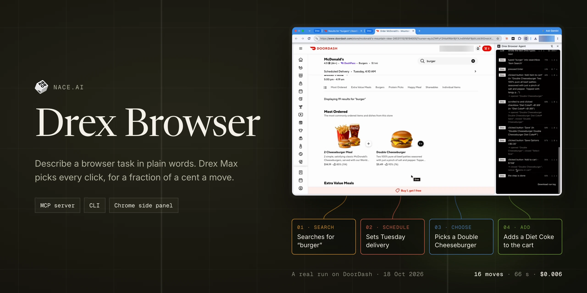
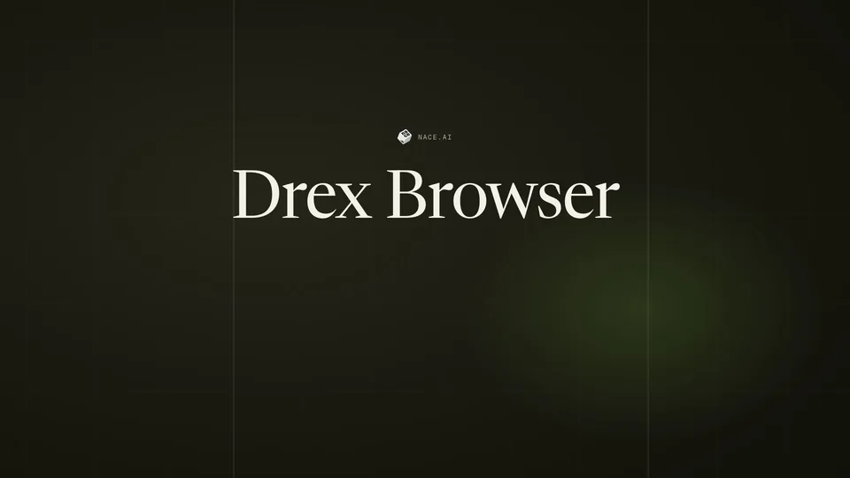

[Quick start](#quick-start-the-local-runner) · [Chrome extension](#the-chrome-extension) · [Benchmarks](#benchmarks) ·
[How it works](#how-it-works) · [Models](#models) · [Safety](#safety) · [Docs](#documentation)

**Describe a browser task in plain words. Drex Browser Use does it in a real browser and tells you what it found.**

**[Drex Max](https://console.nace.ai/docs) takes the actions.** It picks each click and keystroke from the page's
controls and screenshots, for a fraction of a cent a move. **An LLM helps:** it plans the task, reads pages and checks
the result. The LLM is your choice: Claude Haiku 5.5 by default, or [another model](#models). Coding agents call it as
an MCP server or a CLI; people use it from a Chrome side panel.



<sub>A real run, sped up 5×: Drex Browser Use fills a DoorDash cart from one sentence and stops before checkout. All 16
moves were Drex Max's; 66 s, $0.006 of model cost.</sub>

What it is good at: tasks on web pages that need clicking, typing, filling forms or reading behind navigation, such as
"find the cheapest 1 TB SSD on this shop and return its name and price" or "fill in this registration form with these
details and tell me the confirmation".

What it will not do: type passwords or payment details, or solve CAPTCHAs. It stops before a click it recognizes as
risky (pay, send, delete, publish, place an order) unless a person approves it. See [Safety](#safety).

## Ways to use it

| | Who it's for | How you run it |
| --- | --- | --- |
| **Local runner** (`nace-browser`) | Coding agents on your machine: Claude Code, Codex, Cursor, Hermes, Pi and any agent with a shell | An MCP server (`nace-browser mcp`) or a CLI (`nace-browser run --json`) that drives its own Chromium. Build it from this repository. |
| **Chrome extension** | People, in their everyday Chrome, with approval cards for risky clicks | A side panel. Build it from this repository and load it unpacked. |
| **Cloud runs** | Apps and servers | Not available yet. |

Nothing is published to npm or the Chrome Web Store: both the runner and the extension are built from a checkout of
this repository, as below.

## Quick start: the local runner

You need Node 22.18 or later, npm and git.

### 1. Get your keys

- **A Drex API key** for Drex Max: sign in at [console.nace.ai](https://console.nace.ai) and create a key under
  [API Keys](https://console.nace.ai/dashboard/api-keys). New accounts get free credit.
- **An Anthropic API key** for Claude Haiku 5.5, from the [Claude Console](https://console.anthropic.com/).

Set both in your shell profile (`~/.zshrc`, `~/.bashrc` or similar), so every agent you start from a shell has them:

```bash
export DREX_API_KEY=nace_sk_...
export ANTHROPIC_API_KEY=sk-ant-...
```

Never put keys in an agent's MCP config file, a project file or a command line you might commit or share. To keep them
out of plain-text dotfiles, read them from your OS keychain instead; see [docs/auth.md](docs/auth.md).

### 2. Build the runner

```bash
git clone https://github.com/nace-ai/drex-browser-harness-pub.git drex-browser
cd drex-browser
npm ci
npm run build:release                      # the extension build the runner loads, into runner/extension/
node runner/bin/nace-browser.mjs install   # Playwright's Chromium, once (about 170 MB)
npm link -w runner                         # optional: puts `nace-browser` on your PATH
```

Check it: `nace-browser --help` (or `node runner/bin/nace-browser.mjs --help`) prints the commands.

### 3. Add it to your agent

The MCP server is `node <checkout>/runner/bin/nace-browser.mjs mcp`, with the absolute path of your checkout. Its three
tools are `browser_task`, `browser_login` and `browser_profiles` ([docs/mcp-tools.md](docs/mcp-tools.md)). A run takes
from a few seconds to a few minutes, so give the tool a long timeout. Snippets for Claude Code, Codex, Cursor, Hermes
and Pi are in [docs/runner.md](docs/runner.md#agents). For Claude Code, from the checkout:

```bash
claude mcp add --scope user nace-browser -- node "$PWD/runner/bin/nace-browser.mjs" mcp
```

### 4. Run a first task

Ask your agent, for example: "Use the browser to find the top story on news.ycombinator.com". Or from a shell:

```bash
nace-browser run "What is the top story? Give its title and points." --url https://news.ycombinator.com --json
```

`--json` prints only the result on standard output: read `status`, `answer_text` and `outcome`. The run log and a final
screenshot are saved under `~/.nace/browser/runs/`. The result shape is in [docs/runner.md](docs/runner.md#the-result).

## The Chrome extension

```bash
npm ci
npm run build        # lint, types and formatting, then the extension into dist/
```

Open `chrome://extensions`, turn on **Developer mode**, choose **Load unpacked** and pick the `dist/` folder. Open the
side panel with **Alt+Shift+D** or the toolbar icon, then enter your Drex API key and an LLM key in its settings (the
gear icon). Each setting is described in [docs/extension-settings.md](docs/extension-settings.md).

Chrome shows a "started debugging this browser" bar while the extension works: it drives tabs through Chrome's
debugger. Close the bar, or press **Stop**, to end a run.

### Loop mode (experimental)

```bash
DREX_MODE=loop npm run build   # the extension in Loop mode, into dist/
```

In Loop mode one LLM conversation holds the whole task. Each turn it reads the page (its text and controls, a
screenshot, or data it pulls out with JavaScript that is checked to only read, not sandboxed), then hands Drex Max one
concrete step to carry out, or clicks a point or drags itself on a canvas or a shape, or answers. Drex Max makes the
moves on the page's controls and hands a step back when it is unsure. It passes more tasks than the default mode on both
[benchmarks](#benchmarks), clearly so on MiniWoB++.

It is for evaluation only for now. Its page reads run LLM-written JavaScript in the page itself, with the page's cookies
and network access; they are checked against a list of patterns, not sandboxed, so a hostile page could steer it into
sending requests as you or sending page text elsewhere. Never use it signed in to an account you care about: use test
sites and throwaway accounts. `npm run build:release` refuses it, so the local runner and the MCP server run the default
mode.

## Benchmarks

<picture>
  <source media="(prefers-color-scheme: dark)" srcset="docs/assets/benchmarks-dark.png">
  
</picture>

<sub>Pass rate, with the model cost of 1,000 tasks at API list prices, how many times Loop mode's cost it is, and the
mean time a task · 🟩 highest pass rate in the row · [methodology](docs/evals.md)</sub>

| Benchmark | <mark>**Drex Browser Use**</mark><br><sub>Loop mode (experimental)</sub> | <sub>Drex Browser Use<br>default mode</sub> | <sub>Claude Code<br>Claude Haiku 5.5</sub> |
| --- | ---: | ---: | ---: |
| **[WebArena-Verified](https://github.com/ServiceNow/webarena-verified)**<br><sub>60 new tasks · admin panel, forum · 2 tries</sub> | <mark>**64%**</mark><br><sub>$5.92 per 1,000 tasks · 53 s</sub> | 58%<br><sub>$7.49 · 1.3× · 70 s</sub> | 🟩&nbsp;**78%**<br><sub>$7.53 · 1.3× · 91 s</sub> |
| **[MiniWoB++](https://github.com/Farama-Foundation/miniwob-plusplus)**<br><sub>78 problems · 39 task types · 2 tries</sub> | <mark>**76%**</mark><br><sub>$2.58 per 1,000 tasks · 24 s</sub> | 60%<br><sub>$2.45 · 1.0× · 18 s</sub> | 🟩&nbsp;**84%**<br><sub>$4.35 · 1.7× · 42 s</sub> |

All three agents use the same LLM, Claude Haiku 5.5, on the same tasks, pass rule, 300-second clock and machine.

- **Loop mode passes more tasks than the default mode:** 76% against 60% on MiniWoB++, a clear gap, and 64% against
  58% of the WebArena-Verified tasks, a gap within this sample's noise. In Loop mode the LLM holds the whole task and
  decides each step, and Drex Max carries the steps out.
- **Claude Code is more accurate:** 78% against Loop mode's 64% on WebArena-Verified, and 84% against 76% on MiniWoB++
  (a gap within this sample's noise).
- **Loop mode costs less and is faster:** on WebArena-Verified a task costs 21% less than with Claude Code and takes 53
  seconds against 91; on MiniWoB++ it costs 41% less and takes 24 seconds against 42.

Loop mode is experimental: build it with `DREX_MODE=loop npm run build` and use it on test sites only (see
[the extension](#loop-mode-experimental)). The release build, the local runner and the MCP server run the default mode.

<sub>Drex Browser Use 0.1.6 and Claude Code 2.1.289, measured on 30 October 2026. The 60 WebArena-Verified tasks had
not been used by us before and were picked by a fixed seed before any attempt ran; they come from the admin panel and
the forum, and 59 of them change something on the site. A MiniWoB++ problem passes when the page's own reward is
exactly 1. Claude Code was given 600 seconds: its passes after 300 seconds count as failures and its cost and time are
counted up to 300 seconds. Cost is the model cost at API list prices, Drex Max and the LLM together for Drex Browser
Use. Intervals, per-site results, what was left out and earlier results: [docs/evals.md](docs/evals.md#latest-results).</sub>

## How it works

<picture>
  <source media="(prefers-color-scheme: dark)" srcset="docs/assets/how-it-works-dark.png">
  
</picture>

- **Drex Max takes the actions.** Every move, whether a click, typing into a field, a key press, a choice in a list or
  a scroll, is picked by Drex Max from the page's controls and a screenshot. In the DoorDash run above, all 16 moves
  were Drex Max's.
- **The LLM helps.** It turns the task into steps, reads pages for the answer and checks the result. It takes a move
  only when Drex Max hands one over because it is unsure or stuck.

## Models

Drex Max always takes the actions; the LLM that helps is your choice: `--model` on the CLI, or the extension's
settings. Only models that read screenshots and have known prices are offered, because every run is metered and capped
in dollars; any other model id is refused.

| Provider | Model | `--model` | Key |
| --- | --- | --- | --- |
| Anthropic | Claude Haiku 5.5 (default) | `claude-haiku-5-5` | `ANTHROPIC_API_KEY` |
| Anthropic | Claude Sonnet 5.5 | `claude-sonnet-5-5` | `ANTHROPIC_API_KEY` |
| Anthropic | Claude Opus 5.5 | `claude-opus-5-5` | `ANTHROPIC_API_KEY` |
| OpenAI | GPT-6 Luna | `gpt-6-luna` | `OPENAI_API_KEY` |
| Google | Gemini 3.8 Flash | `gemini-3.8-flash` | `GOOGLE_API_KEY` or `GEMINI_API_KEY` |
| Fireworks | GLM-5.3 Flash | `accounts/fireworks/models/glm-5p3-flash` | `FIREWORKS_API_KEY` |
| OpenRouter | Claude Haiku 5.5 | `anthropic/claude-haiku-5.5` | `OPENROUTER_API_KEY` |
| OpenRouter | GPT-6 Luna | `openai/gpt-6-luna` | `OPENROUTER_API_KEY` |

MCP runs always use the default model, so they need `ANTHROPIC_API_KEY`. A pricier model raises a run's default cost limit in proportion to its price
([docs/runner.md](docs/runner.md)).

## Safety

- **Risky actions are denied by default in the runner and the MCP server.** When the next move is a click recognized
  as pay, send, delete, publish or place an order, a click at a screen point whose target is risky or unknown, a drag or
  other gesture, or a bulk action over list items, the run stops before it with the outcome `risky_action_denied`. A
  person can turn this off for one CLI run with `--allow-risky`; the MCP tools have no such option.
- **The extension asks instead.** With **Ask before risky actions** on (the default), the side panel shows an approval
  card: Stop, Allow once, or Allow for this task. Turned off, the extension makes those clicks without asking.
- **The guard is best-effort, not a security boundary.** It recognizes risky controls by their names, with a list of
  English words. Labels in other languages, and words such as "Submit", "Confirm", "Save" or "Approve", are not
  recognized, and a form submitted with Enter is not gated. Use it only on tasks and signed-in accounts where you accept
  that it may send, pay or delete.
- **No credentials are typed.** A sign-in screen or a CAPTCHA ends the run (`blocked_login`, `blocked_captcha`). You
  sign in once yourself, in a visible window (`nace-browser login <url>`), and later runs on that profile are signed in.
- **Pages are data, not instructions.** Text on a page is treated as content to read, not as commands. This lowers the
  risk of prompt injection from a hostile page; it does not remove it.
- **Limits.** Each run stops at a cost, time and LLM-call limit ($0.04, 600 s and 20 calls by default). An agent on MCP
  can lower the limits, never raise them.
- **Profiles are separate.** The runner uses browser profiles of its own, never your everyday Chrome profile, one run
  per profile at a time. A profile signed in to a site gives every run on it that session, so keep separate profiles
  for separate trust.
- **Pairing a coding agent with the extension** (the setting **Let coding agents use Drex**, off by default) gives that
  agent runs in your everyday Chrome. Its `drex_tabs`, `drex_read_page` and `drex_screenshot` tools see only the tabs
  its own runs opened or worked in, never your other tabs. A risky step in a run it starts always ends the run and hands
  control back, whatever your **Ask before risky actions** setting. Turn pairing on only for agents you trust, and
  prefer the local runner, which has its own profiles.

## Privacy

Nothing is sent anywhere until you, or an agent you set up, start a task. There is no telemetry and no analytics in the
extension or the runner. During a task:

- **Drex** (`console.nace.ai`, run by Nace AI) receives, for each move, screenshots of the page, the page's controls
  with their labels and nearby text, the task or current step, and the moves so far.
- **Your LLM provider** (Anthropic by default) receives the task, today's date, page text, screenshots and controls.
  In the extension it also receives the titles and URLs of your open tabs.
- **On your machine:** settings, browser profiles, run logs and screenshots.

Pages can hold whatever the task touches, including personal data. How Drex and your LLM provider keep and use it is
governed by their own terms. Details and links are in [docs/privacy.md](docs/privacy.md).

## Limitations and known issues

- **Accuracy:** on 60 new WebArena-Verified tasks the default mode passes 58% and the experimental Loop mode 64%, where
  Claude Code with Haiku 5.5 passes 78%; see [Benchmarks](#benchmarks). Check the answer of a run that matters.
- **Loop mode is for evaluation only** until its page reads are sandboxed: never use it on accounts you care about; see
  [Loop mode](#loop-mode-experimental).
- **Risk detection is English-only and name-based**, as described under [Safety](#safety).
- **No npm package or Chrome Web Store listing yet:** build from source.
- **Cloud runs are not available yet.**
- The runner uses Playwright's Chromium, not branded Google Chrome, which no longer loads an unpacked extension from
  the command line.
- Content inside iframes is only partly supported, and heavy pages take about 2 to 3 seconds a move.

## Troubleshooting

| Problem | What to do |
| --- | --- |
| `missing_keys` | The process that started the runner has no `DREX_API_KEY` or `ANTHROPIC_API_KEY`. Set them in your shell profile, start the agent from a new shell, and check that the agent passes them to MCP servers ([docs/runner.md](docs/runner.md#agents)). |
| `internal_error` with `invalid x-api-key` or a 401 | A key is wrong or revoked. Check it in [console.nace.ai](https://console.nace.ai/dashboard/api-keys) or the Claude Console. |
| `browser_missing` | Run `node runner/bin/nace-browser.mjs install`. On a bare Linux machine, add `--with-deps` for Chromium's system packages. |
| `extension_missing` | Run `npm run build:release` in the checkout. |
| `profile_busy` | Another run, or another Chromium, has the profile. Wait, use `--profile <other>` or `--temp-profile`. If no run is going, delete the lock file the message names (`~/.nace/browser/profiles/<name>.lock`). |
| The agent's tool call times out | Raise the agent's MCP tool timeout to 900 seconds (Codex's default is 60 s). |
| `blocked_login` | Run `nace-browser login <url>`, sign in in the window that opens, close it, and run the task again. |

## Repository layout

| Path | What's in it |
| --- | --- |
| `src/` | The Chrome extension: the agent, the side panel, the providers and the site tips |
| `runner/` | The `nace-browser` CLI and MCP server, and the cloud worker entry |
| `mcp/` | The local MCP server a paired coding agent uses to give the extension tasks |
| `sandbox/` | Builds the cloud worker's sandbox image (for maintainers) |
| `plugins/`, `.claude-plugin/` | The Claude Code plugin and its marketplace entry |
| `test/` | Unit and browser tests |
| `e2e/` | Synthetic test pages (a mailbox, forms, menus, a checkout) and the scripts that drive the extension on them |
| `scripts/` | Build helpers, and `readme-assets.mjs`, which renders the README's images |
| `docs/` | The guides listed under [Documentation](#documentation); `docs/assets/` holds the README's images and `docs/assets/src/benchmarks.json` their numbers |
| `third_party/` | The license and upstream commit of browser-use/browser-harness |

## Documentation

| Page | What's in it |
| --- | --- |
| [docs/runner.md](docs/runner.md) | The local runner: setup for each coding agent, the CLI, profiles and the result |
| [docs/mcp-tools.md](docs/mcp-tools.md) | `browser_task`, `browser_login` and `browser_profiles`: arguments, results and errors |
| [docs/auth.md](docs/auth.md) | Keys: where to get them and how to keep them safe |
| [docs/extension-settings.md](docs/extension-settings.md) | Every setting in the Chrome extension |
| [docs/privacy.md](docs/privacy.md) | What data goes where |
| [docs/evals.md](docs/evals.md) | How we measure accuracy and cost, and the latest numbers |
| [docs/worker.md](docs/worker.md) | Maintainer notes on the cloud worker entry |

## Contributing and security

See [CONTRIBUTING.md](CONTRIBUTING.md). Report vulnerabilities privately, as described in [SECURITY.md](SECURITY.md), not in a public
issue. Changes are recorded in [CHANGELOG.md](CHANGELOG.md).

## Credits

Drex Browser Use is partly built on [browser-use/browser-harness](https://github.com/browser-use/browser-harness) (MIT),
including its site tips, key-by-key typing and background-tab approach. Its license and the upstream commit are kept in
`third_party/`; see [NOTICE](NOTICE). The extension uses the Inter and Geist Mono fonts (SIL Open Font License).

## License

[MIT](LICENSE). The Nace and Drex names and the Nace logo are not covered by the license.

<sub>[Docs](#documentation) · [Contributing](CONTRIBUTING.md) · [Security](SECURITY.md) · [Changelog](CHANGELOG.md) ·
MIT, © 2026 [Nace AI](https://nace.ai) · [Notices](NOTICE)</sub>
