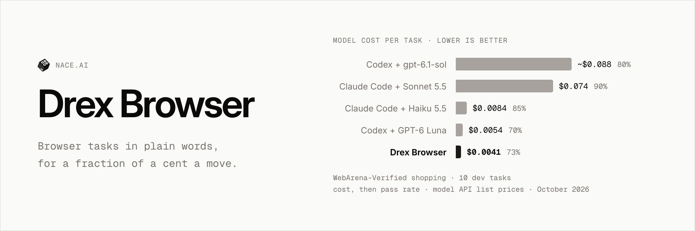
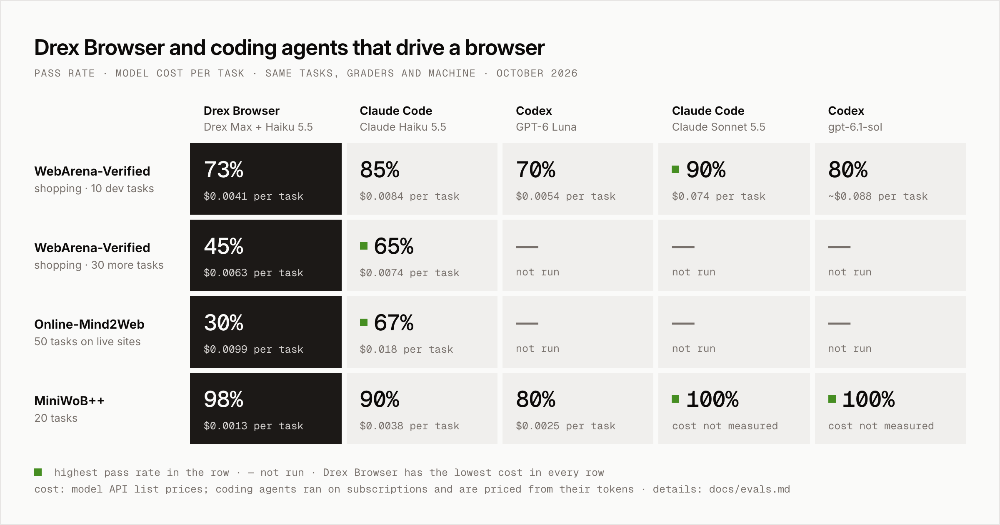

<picture>
  <source media="(max-width: 600px)" srcset="docs/assets/header-narrow.png">
  <source media="(prefers-color-scheme: dark)" srcset="docs/assets/header-dark.png">
  
</picture>

**Describe a browser task in plain words. Drex Browser does it in a real browser and tells you what it found.**

[Drex Max](https://console.nace.ai/docs) picks each click and keystroke from the page's controls and screenshots, for a
fraction of a cent a move. A small LLM (Claude Haiku 5.5 by default) plans the task, reads pages and checks the
result. Coding agents call it as an MCP server or a CLI; people use it from a Chrome side panel.

What it is good at: tasks on web pages that need clicking, typing, filling forms or reading behind navigation, such as
"find the cheapest 1 TB SSD on this shop and return its name and price" or "fill in this registration form with these
details and tell me the confirmation".

What it will not do: type passwords or payment details, or solve CAPTCHAs. It stops before a click it recognizes as
risky (pay, send, delete, publish, place an order) unless a person approves it. See [Safety](#safety).

[Quick start](#quick-start-the-local-runner) · [Chrome extension](#the-chrome-extension) · [Benchmarks](#benchmarks) ·
[How it works](#how-it-works) · [Safety](#safety) · [Docs](#documentation)

## Ways to use it

| | Who it's for | How you run it |
| --- | --- | --- |
| **Local runner** (`nace-browser`) | Coding agents on your machine: Claude Code, Codex, Cursor, Hermes, Pi and any agent with a shell | An MCP server (`nace-browser mcp`) or a CLI (`nace-browser run --json`) that drives its own Chromium. Build it from this repository. |
| **Chrome extension** | People, in their everyday Chrome, with approval cards for risky clicks | A side panel. Build it from this repository and load it unpacked. |
| **Cloud runs** | Apps and servers | Not available yet. |

Nothing is published to npm or the Chrome Web Store: both the runner and the extension are built from a checkout of
this repository, as below.

## Quick start: the local runner

You need Node 22.18 or later, npm and git.

### 1. Get your keys

- **A Drex API key** for Drex Max: sign in at [console.nace.ai](https://console.nace.ai) and create a key under
  [API Keys](https://console.nace.ai/dashboard/api-keys). New accounts get free credit.
- **An Anthropic API key** for Claude Haiku 5.5, from the [Claude Console](https://console.anthropic.com/).

Set both in your shell profile (`~/.zshrc`, `~/.bashrc` or similar), so every agent you start from a shell has them:

```bash
export DREX_API_KEY=nace_sk_...
export ANTHROPIC_API_KEY=sk-ant-...
```

Never put keys in an agent's MCP config file, a project file or a command line you might commit or share. To keep them
out of plain-text dotfiles, read them from your OS keychain instead; see [docs/auth.md](docs/auth.md).

### 2. Build the runner

```bash
git clone https://github.com/nace-ai/drex-browser-harness-pub.git drex-browser
cd drex-browser
npm ci
npm run build:release                      # the extension build the runner loads, into runner/extension/
node runner/bin/nace-browser.mjs install   # Playwright's Chromium, once (about 170 MB)
npm link -w runner                         # optional: puts `nace-browser` on your PATH
```

Check it: `nace-browser --help` (or `node runner/bin/nace-browser.mjs --help`) prints the commands.

### 3. Add it to your agent

The MCP server is `node <checkout>/runner/bin/nace-browser.mjs mcp`, with the absolute path of your checkout. Its three
tools are `browser_task`, `browser_login` and `browser_profiles` ([docs/mcp-tools.md](docs/mcp-tools.md)). A run takes
from a few seconds to a few minutes, so give the tool a long timeout. Snippets for Claude Code, Codex, Cursor, Hermes
and Pi are in [docs/runner.md](docs/runner.md#agents). For Claude Code, from the checkout:

```bash
claude mcp add --scope user nace-browser -- node "$PWD/runner/bin/nace-browser.mjs" mcp
```

### 4. Run a first task

Ask your agent, for example: "Use the browser to find the top story on news.ycombinator.com". Or from a shell:

```bash
nace-browser run "What is the top story? Give its title and points." --url https://news.ycombinator.com --json
```

`--json` prints only the result on standard output: read `status`, `answer_text` and `outcome`. The run log and a final
screenshot are saved under `~/.nace/browser/runs/`. The result shape is in [docs/runner.md](docs/runner.md#the-result).

## The Chrome extension

```bash
npm ci
npm run build        # lint, types and formatting, then the extension into dist/
```

Open `chrome://extensions`, turn on **Developer mode**, choose **Load unpacked** and pick the `dist/` folder. Open the
side panel with **Alt+Shift+D** or the toolbar icon, then enter your Drex API key and an LLM key in its settings (the
gear icon). Each setting is described in [docs/extension-settings.md](docs/extension-settings.md).

Chrome shows a "started debugging this browser" bar while the extension works: it drives tabs through Chrome's
debugger. Close the bar, or press **Stop**, to end a run.

## Benchmarks

<picture>
  <source media="(prefers-color-scheme: dark)" srcset="docs/assets/benchmarks-dark.png">
  
</picture>

<sub>Pass rate, with the model cost per task at API list prices below it · 🟩 highest pass rate in the row ·
— not run · [methodology](docs/evals.md)</sub>

| Benchmark | <mark>**Drex Browser**</mark><br><sub>Drex Max + Haiku 5.5</sub> | <sub>Claude Code<br>Haiku 5.5</sub> | <sub>Codex<br>GPT-6 Luna</sub> | <sub>Claude Code<br>Sonnet 5.5</sub> | <sub>Codex<br>gpt-6.1-sol</sub> |
| --- | ---: | ---: | ---: | ---: | ---: |
| **WebArena-Verified**<br><sub>shopping · 10 dev tasks</sub> | <mark>**73%**</mark><br><sub>$0.0041 per task</sub> | 85%<br><sub>$0.0084 per task</sub> | 70%<br><sub>$0.0054 per task</sub> | 🟩&nbsp;**90%**<br><sub>$0.074 per task</sub> | 80%<br><sub>~$0.088 per task</sub> |
| **WebArena-Verified**<br><sub>shopping · 30 more tasks</sub> | <mark>**45%**</mark><br><sub>$0.0063 per task</sub> | 🟩&nbsp;**65%**<br><sub>$0.0074 per task</sub> | — | — | — |
| **Online-Mind2Web**<br><sub>50 tasks on live sites</sub> | <mark>**30%**</mark><br><sub>$0.0099 per task</sub> | 🟩&nbsp;**67%**<br><sub>$0.018 per task</sub> | — | — | — |
| **MiniWoB++**<br><sub>20 tasks</sub> | <mark>**98%**</mark><br><sub>$0.0013 per task</sub> | 90%<br><sub>$0.0038 per task</sub> | 80%<br><sub>$0.0025 per task</sub> | 🟩&nbsp;**100%**<br><sub>cost not measured</sub> | 🟩&nbsp;**100%**<br><sub>cost not measured</sub> |

Drex Browser has the lowest cost in every row and leads on short tasks (MiniWoB++). On longer tasks, the 30 further
WebArena tasks and the live sites of Online-Mind2Web, it trails Claude Code with Haiku. Closing that gap is the work in
progress.

<sub>Drex Browser 0.1.0 on 20 October 2026; the coding agents on 19 and 20 October 2026, with the same tasks, graders
and machine. The coding agents ran on subscriptions and are priced from their token counts.
Online-Mind2Web is judged by WebJudge with Claude Sonnet 5.5, whose cost is not included. Failures on all 40 WebArena
tasks have been studied while developing the agent; further held-out tasks are kept back for release numbers. Times per task and how to
rerun: [docs/evals.md](docs/evals.md#latest-results).</sub>

## How it works

<picture>
  <source media="(prefers-color-scheme: dark)" srcset="docs/assets/how-it-works-dark.png">
  
</picture>

## Safety

- **Risky actions are denied by default in the runner and the MCP server.** When the next move is a click recognized
  as pay, send, delete, publish or place an order, a click at a screen point whose target is risky or unknown, a drag or
  other gesture, or a bulk action over list items, the run stops before it with the outcome `risky_action_denied`. A
  person can turn this off for one CLI run with `--allow-risky`; the MCP tools have no such option.
- **The extension asks instead.** With **Ask before risky actions** on (the default), the side panel shows an approval
  card: Stop, Allow once, or Allow for this task. Turned off, the extension makes those clicks without asking.
- **The guard is best-effort, not a security boundary.** It recognizes risky controls by their names, with a list of
  English words. Labels in other languages, and words such as "Submit", "Confirm", "Save" or "Approve", are not
  recognized, and a form submitted with Enter is not gated. Use it only on tasks and signed-in accounts where you accept
  that it may send, pay or delete.
- **No credentials are typed.** A sign-in screen or a CAPTCHA ends the run (`blocked_login`, `blocked_captcha`). You
  sign in once yourself, in a visible window (`nace-browser login <url>`), and later runs on that profile are signed in.
- **Pages are data, not instructions.** Text on a page is treated as content to read, not as commands. This lowers the
  risk of prompt injection from a hostile page; it does not remove it.
- **Limits.** Each run stops at a cost, time and LLM-call limit ($0.04, 600 s and 20 calls by default). An agent on MCP
  can lower the limits, never raise them.
- **Profiles are separate.** The runner uses browser profiles of its own, never your everyday Chrome profile, one run
  per profile at a time. A profile signed in to a site gives every run on it that session, so keep separate profiles
  for separate trust.
- **Pairing a coding agent with the extension** (the setting **Let coding agents use Drex**, off by default) gives that
  agent runs in your everyday Chrome. Its `drex_tabs`, `drex_read_page` and `drex_screenshot` tools see only the tabs
  its own runs opened or worked in, never your other tabs. A risky step in a run it starts always ends the run and hands
  control back, whatever your **Ask before risky actions** setting. Turn pairing on only for agents you trust, and
  prefer the local runner, which has its own profiles.

## Privacy

Nothing is sent anywhere until you, or an agent you set up, start a task. There is no telemetry and no analytics in the
extension or the runner. During a task:

- **Drex** (`console.nace.ai`, run by Nace AI) receives, for each move, screenshots of the page, the page's controls
  with their labels and nearby text, the task or current step, and the moves so far.
- **Your LLM provider** (Anthropic by default) receives the task, today's date, page text, screenshots and controls.
  In the extension it also receives the titles and URLs of your open tabs.
- **On your machine:** settings, browser profiles, run logs and screenshots.

Pages can hold whatever the task touches, including personal data. How Drex and your LLM provider keep and use it is
governed by their own terms. Details and links are in [docs/privacy.md](docs/privacy.md).

## Limitations and known issues

- **Accuracy:** 73% on the WebArena-Verified shopping development tasks, 45% on 30 further tasks and 30% on live sites
  (Online-Mind2Web), where Claude Code with Haiku 5.5 gets 85%, 65% and 67%; see [Benchmarks](#benchmarks). Check the
  answer of a run that matters.
- **Risk detection is English-only and name-based**, as described under [Safety](#safety).
- **No npm package or Chrome Web Store listing yet:** build from source.
- **Cloud runs are not available yet.**
- The runner uses Playwright's Chromium, not branded Google Chrome, which no longer loads an unpacked extension from
  the command line.
- Content inside iframes is only partly supported, and heavy pages take about 2 to 3 seconds a move.
- Other LLM providers work too (OpenAI, Google Gemini, OpenRouter, Fireworks; `--model` on the CLI, or the extension's
  settings), but accuracy was measured with Claude Haiku 5.5.

## Troubleshooting

| Problem | What to do |
| --- | --- |
| `missing_keys` | The process that started the runner has no `DREX_API_KEY` or `ANTHROPIC_API_KEY`. Set them in your shell profile, start the agent from a new shell, and check that the agent passes them to MCP servers ([docs/runner.md](docs/runner.md#agents)). |
| `internal_error` with `invalid x-api-key` or a 401 | A key is wrong or revoked. Check it in [console.nace.ai](https://console.nace.ai/dashboard/api-keys) or the Claude Console. |
| `browser_missing` | Run `node runner/bin/nace-browser.mjs install`. On a bare Linux machine, add `--with-deps` for Chromium's system packages. |
| `extension_missing` | Run `npm run build:release` in the checkout. |
| `profile_busy` | Another run, or another Chromium, has the profile. Wait, use `--profile <other>` or `--temp-profile`. If no run is going, delete the lock file the message names (`~/.nace/browser/profiles/<name>.lock`). |
| The agent's tool call times out | Raise the agent's MCP tool timeout to 900 seconds (Codex's default is 60 s). |
| `blocked_login` | Run `nace-browser login <url>`, sign in in the window that opens, close it, and run the task again. |

## Repository layout

| Path | What's in it |
| --- | --- |
| `src/` | The Chrome extension: the agent, the side panel, the providers and the site tips |
| `runner/` | The `nace-browser` CLI and MCP server, and the cloud worker entry |
| `mcp/` | The local MCP server a paired coding agent uses to give the extension tasks |
| `sandbox/` | Builds the cloud worker's sandbox image (for maintainers) |
| `plugins/`, `.claude-plugin/` | The Claude Code plugin and its marketplace entry |
| `test/` | Unit and browser tests |
| `e2e/` | Synthetic test pages (a mailbox, forms, menus, a checkout) and the scripts that drive the extension on them |
| `scripts/` | Build helpers, and `readme-assets.mjs`, which renders the README's images |
| `docs/` | The guides listed under [Documentation](#documentation); `docs/assets/` holds the README's images and `docs/assets/src/benchmarks.json` their numbers |
| `third_party/` | The license and upstream commit of browser-use/browser-harness |

## Documentation

| Page | What's in it |
| --- | --- |
| [docs/runner.md](docs/runner.md) | The local runner: setup for each coding agent, the CLI, profiles and the result |
| [docs/mcp-tools.md](docs/mcp-tools.md) | `browser_task`, `browser_login` and `browser_profiles`: arguments, results and errors |
| [docs/auth.md](docs/auth.md) | Keys: where to get them and how to keep them safe |
| [docs/extension-settings.md](docs/extension-settings.md) | Every setting in the Chrome extension |
| [docs/privacy.md](docs/privacy.md) | What data goes where |
| [docs/evals.md](docs/evals.md) | How we measure accuracy and cost, and the latest numbers |
| [docs/worker.md](docs/worker.md) | Maintainer notes on the cloud worker entry |

## Contributing and security

See [CONTRIBUTING.md](CONTRIBUTING.md). Report vulnerabilities privately, as described in [SECURITY.md](SECURITY.md), not in a public
issue. Changes are recorded in [CHANGELOG.md](CHANGELOG.md).

## Credits

Drex Browser is partly built on [browser-use/browser-harness](https://github.com/browser-use/browser-harness) (MIT),
including its site tips, key-by-key typing and background-tab approach. Its license and the upstream commit are kept in
`third_party/`; see [NOTICE](NOTICE). The extension uses the Inter and Geist Mono fonts (SIL Open Font License).

## License

[MIT](LICENSE). The Nace and Drex names and the Nace logo are not covered by the license.

<sub>[Docs](#documentation) · [Contributing](CONTRIBUTING.md) · [Security](SECURITY.md) · [Changelog](CHANGELOG.md) ·
MIT, © 2026 [Nace AI](https://nace.ai) · [Notices](NOTICE)</sub>
